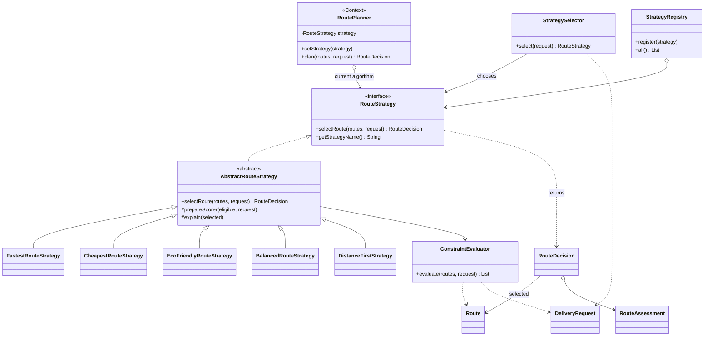
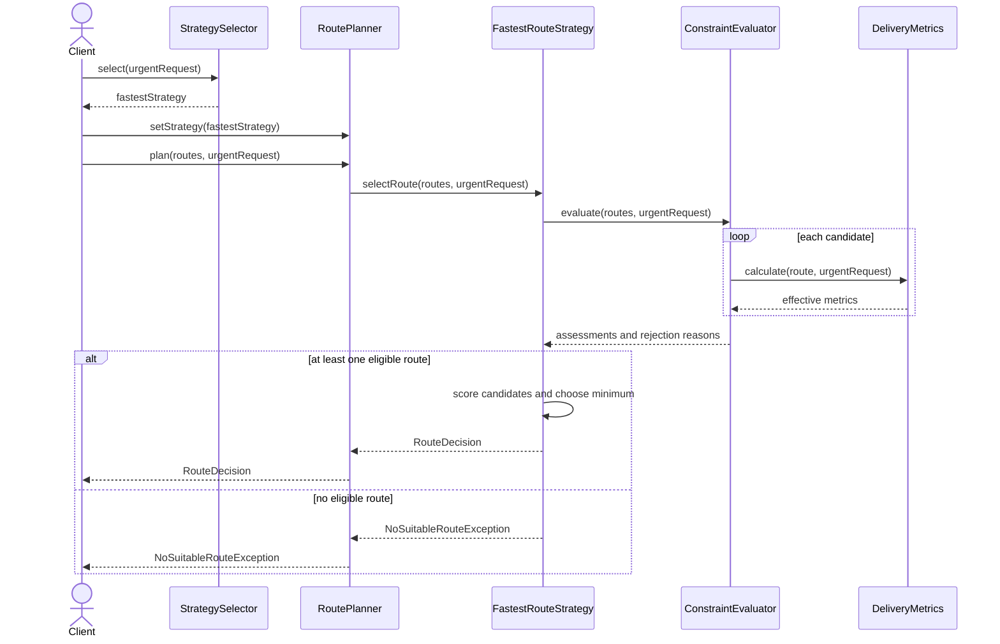

# Smart Delivery and Route Optimization Engine

Assignment 5 demonstrates the Strategy pattern in Java 17. The application chooses one route from eight supplied candidates. It does not calculate road paths or call a mapping service.

## Build and run

Open this folder as a Maven project and select JDK 17 or newer.

```shell
mvn test
mvn package
java -jar target/smart-delivery-1.0.0.jar
```

On Windows, the main application can also be compiled and run without Maven:

```powershell
.\run.ps1
```

The script does not run JUnit tests. The archive includes a prebuilt executable at `dist/smart-delivery-1.0.0.jar`; run it with Java 17+.

## Architecture

`RoutePlanner` is the Context. It stores a `RouteStrategy`, supports `setStrategy`, and delegates `plan` to the current algorithm. It contains no algorithm-selection switch, concrete-strategy checks or scoring formulas.

`RouteStrategy` is the Strategy interface. Its `selectRoute` returns `RouteDecision` rather than just `Route`. This intentional improvement provides the selected route, effective metrics, objective score, explanation and assessments of every candidate. Failure is represented by `NoSuitableRouteException`, never a null selected route.

The Concrete Strategies are `FastestRouteStrategy`, `CheapestRouteStrategy`, `EcoFriendlyRouteStrategy`, `BalancedRouteStrategy` and the later-added `DistanceFirstStrategy`.

`AbstractRouteStrategy` shares the filter/rank workflow. Each concrete algorithm supplies its objective function and explanation. `ConstraintEvaluator` enforces shared hard constraints. `DeliveryMetrics` calculates effective metrics consistently, so budget and deadline checks use the same values that appear in ranking and output.

`StrategySelector` selects a policy from a request. It uses an injected priority-to-strategy map; it does not score routes. `StrategyRegistry` registers named algorithms. `StrategyComparison` runs every registered algorithm for the same request and records individual no-route failures.

### UML class diagram



Editable PlantUML: [class diagram](docs/class-diagram.puml).

### UML sequence diagram



Editable PlantUML: [sequence diagram](docs/sequence-diagram.puml).

## Domain and hard constraints

`Location`, `Route`, `DeliveryRequest`, `RouteMetrics`, `RouteAssessment` and `RouteDecision` are domain records. Lists exposed by decisions are immutable copies. Route identifiers must be unique.

Candidate routes are rejected before scoring if unavailable, if endpoints do not match, or if effective time, total cost or emissions exceed request limits. Exact equality with a limit is allowed. Negative and non-finite numeric inputs are rejected. Zero-valued limits and metrics are allowed. Missing required objects are rejected explicitly.

Each rejection reason is retained. Only eligible routes receive scores; a rejected assessment has no score. An empty list and an entirely infeasible list throw `NoSuitableRouteException`, which retains all available assessments.

## Formulas and units

Costs use a common demonstration currency unit, distance is in km, time in minutes and emissions in estimated kg CO2.

```text
effectiveTime = estimatedMinutes + trafficPenaltyMinutes + weatherPenaltyMinutes
prioritySurcharge = 300 for URGENT, otherwise 0
totalCost = baseCost + distanceKm * costPerKm + additionalFee + prioritySurcharge
```

The full cost is shared because all strategies must respect the budget. The Cheapest strategy's objective is to minimize this full cost, rather than baseCost alone. Fastest minimizes effectiveTime, including traffic and weather.

Eco calculates its objective inside `EcoFriendlyRouteStrategy`:

```text
ecoScore = emissionKg * 1.0 + distanceKm * 0.05
```

These coefficients are an explicit teaching policy, not a measured environmental model. This policy belongs in the Eco strategy because changing the environmental trade-off must not change the Context or unrelated algorithms.

Balanced normalizes each metric among eligible candidates:

```text
normalized(x) = (x - min) / (max - min)
normalized(x) = 0 when max == min

score = normalizedTime * timeWeight
      + normalizedCost * costWeight
      + normalizedDistance * distanceWeight
      + normalizedEmission * emissionWeight
```

Normalization prevents large monetary numbers from dominating time or emissions merely because of their units. Rejected candidates do not influence the ranges. A criterion shared by all eligible routes contributes zero because it cannot distinguish them.

The default weights are `0.40, 0.30, 0.10, 0.20`. Every weight must be finite and within [0,1]; the sum must equal 1 within an absolute tolerance of 1e-9. Zero weights are allowed. Invalid weights throw `IllegalArgumentException`.

For the default winner R6:

```text
time     = (29 - 22) / (48 - 22)       = 0.26923077
cost     = (2005 - 1240) / (4300-1240)  = 0.25
distance = (11 - 7) / (22 - 7)         = 0.26666667
emission = (1.6 - 0.6) / (8 - 0.6)     = 0.13513514
score    = 0.4*time + 0.3*cost + 0.1*distance + 0.2*emission
         = 0.23638600
```

DistanceFirst minimizes feasible distance. All strategies resolve equal scores by lexicographically smaller route ID. Scores have different meanings across algorithms and must not be compared directly across strategies; compare the resulting route metrics instead.

## Demonstration data

All eight routes share the request endpoints. Values below are for STANDARD priority.

| ID | Effective min | Total cost | km | kg CO2 | Available |
| --- | ---: | ---: | ---: | ---: | --- |
| R1-express | 22 | 3000 | 10 | 5.0 | yes |
| R2-economy | 48 | 1240 | 16 | 6.0 | yes |
| R3-green | 35 | 1540 | 12 | 0.6 | yes |
| R4-short | 44 | 2390 | 7 | 2.8 | yes |
| R5-highway | 22 | 4300 | 22 | 8.0 | yes |
| R6-balanced | 29 | 2005 | 11 | 1.6 | yes |
| R7-closed | 10 | 200 | 9 | 0.2 | no |
| R8-rural | 44 | 1850 | 19 | 2.2 | yes |

## Runtime switching and automatic selection

`Main`, section 2, constructs one planner with Fastest and then makes three switches: Cheapest, Eco and Balanced. The Context object stays the same.

Automatic rules are configured in `DemoData.selector`:

| Request priority | Strategy |
| --- | --- |
| URGENT | Fastest |
| ECONOMY | Cheapest |
| ECO | Eco |
| STANDARD | Balanced |

For STANDARD only, `ecoPreferred=true` chooses Eco. An explicit URGENT/ECONOMY/ECO priority takes precedence over that preference. Hard constraints are always enforced; urgency cannot override the budget.

Section 4 demonstrates dynamic requests with the same Fastest object: a budget of 5000 selects R1, while a budget of 2500 excludes R1 and selects R6.

## Example output and errors

```text
Fastest       -> R1-express  | time=22 min | cost=3000 | distance=10 km | CO2=5.0 kg
Cheapest      -> R2-economy  | time=48 min | cost=1240 | distance=16 km | CO2=6.0 kg
Eco           -> R3-green    | time=35 min | cost=1540 | distance=12 km | CO2=0.6 kg
Balanced      -> R6-balanced | time=29 min | cost=2005 | distance=11 km | CO2=1.6 kg
DistanceFirst -> R4-short    | time=44 min | cost=2390 | distance=7 km  | CO2=2.8 kg
```

The exact captured output is in [docs/demo-output.txt](docs/demo-output.txt). Section 5 prints the selected explanation, every candidate's score and all rejection reasons. Section 6 explicitly demonstrates an empty route list, no feasible route, invalid weights and negative distance.

## Tests and verification

JUnit 5 verification completed on 19 October 2026: **47 test runs, 0 failures, 0 errors, 0 skipped**.

| Test class | Runs | Covered behavior |
| --- | ---: | --- |
| StrategyTest | 21 | Five expected winners, penalties, complete cost, Eco formula, normalization, configurable and invalid weights, tie-breaking, request changes, immutable results |
| ConstraintTest | 14 | Availability, budget, deadline, emissions, endpoints, exact and zero boundaries, surcharge, no-route diagnostics, invalid and missing data |
| PlanningTest | 12 | Three runtime switches, selector mappings and precedence, extension, five-strategy comparison, failures, registry and Context validation |

See [verification](docs/verification.txt). These are synthetic local checks of deterministic candidate selection, not evidence of a live routing or logistics integration.

## Why Strategy and how to extend it

Each interchangeable algorithm implements the same interface and the Context delegates to it. Adding one more algorithm does not require a new branch in `RoutePlanner`. Selection rules live in a separate component; they are not mixed into algorithm implementations.

`DistanceFirstStrategy` was added after the four-strategy application compiled and ran. Its separate commit adds one new class and one registry entry in `DemoData`. Zero changes were made to `RoutePlanner`, the interface or the original strategies.

To add another algorithm: implement `RouteStrategy` or extend `AbstractRouteStrategy`, register it, add meaningful tests and optionally map it to a request policy. The registry automatically includes it in comparison mode.

## Strategy versus Bridge

The previous notification assignment used Bridge to connect two independently growing hierarchies: notification types and delivery channels. This assignment uses Strategy to replace the algorithm solving one task: selecting a route. Both use composition, but their design purposes differ.

## SOLID and limitations

SRP: the Context delegates, concrete strategies score, the selector chooses a policy, the evaluator enforces constraints, and the reporter prints results.

OCP: a new algorithm is introduced through the Strategy abstraction and registration, without changing the Context.

DIP: `RoutePlanner` depends on `RouteStrategy`, not on Fastest, Cheapest or any other concrete class.

The system selects among supplied candidates rather than finding paths in a road network, solving multi-stop vehicle routing, measuring live traffic or predicting emissions. Metrics and coefficients are synthetic. Money uses double for this teaching exercise; a financial system should define decimal precision and rounding. Location equality uses record values, not proximity. Constraints are fixed in one evaluator, so adding a new constraint type requires extending that component. Min-max normalization depends on the eligible candidate set. The mutable planner and registry are not designed for concurrent modification.

Each strategy takes O(n) time and O(n) additional space for n candidates, excluding string formatting costs. Balanced computes ranges once, then scores each candidate in constant time. Comparing s strategies takes O(s*n) time and retains O(s*n) assessments.

## Git history and submission

The local project contains more than eight meaningful sequential commits, including the fifth strategy in a separate commit. Inspect with:

```shell
git log --oneline --reverse
git show --stat 30dc5b6
```

The commits were created sequentially during this implementation on 19 October 2026.

The project is published at [danserot/5-Assigment-SDP](https://github.com/danserot/5-Assigment-SDP). Submit the public repository link and this README/report through Moodle according to the course requirements.
